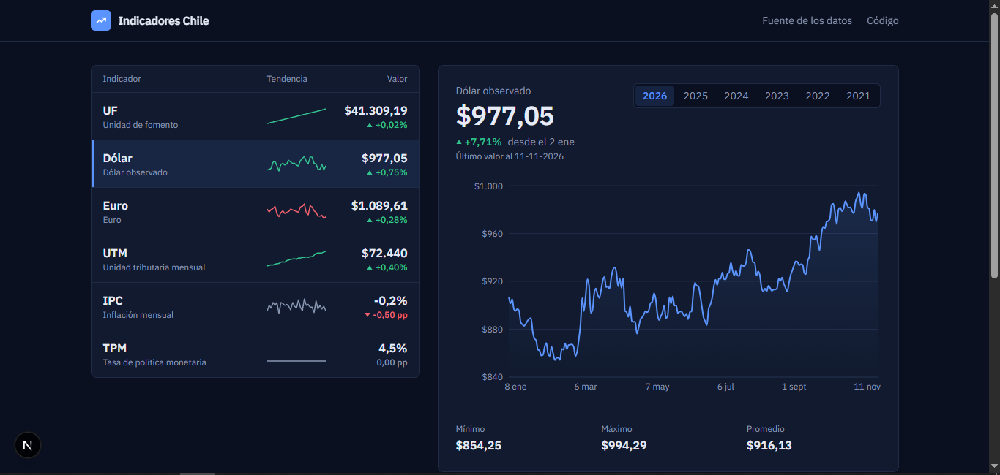
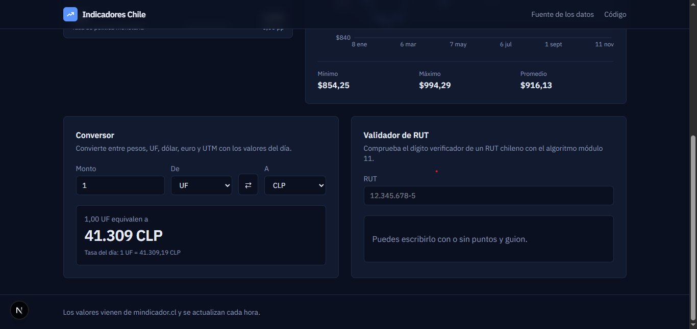
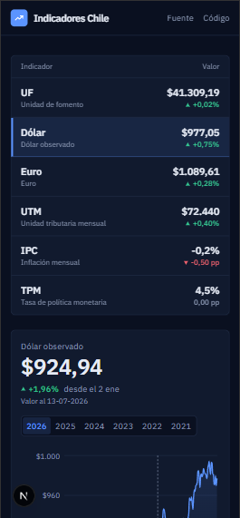
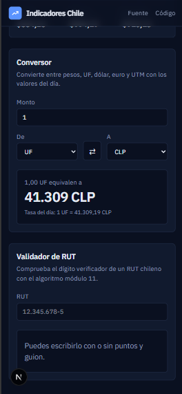

# Indicadores Chile

Panel web con los indicadores económicos de Chile (UF, dólar, euro, UTM, IPC y TPM): valores actuales, variación, historial por año, conversor de monedas y validador de RUT.

**Demo en línea:** [indicadores-chile-nu.vercel.app](https://indicadores-chile-nu.vercel.app)





<p align="center">
  
  &nbsp;&nbsp;
  
</p>

## Qué incluye

- **Pizarra de indicadores:** valor actual, variación respecto del dato anterior y una mini línea con los últimos 30 días.
- **Historial por año:** gráfico de área con mínimo, máximo y promedio del período. Al pasar el cursor, el encabezado muestra el valor y la fecha de ese punto, y la variación desde el inicio del período.
- **Conversor:** entre pesos, UF, dólar, euro y UTM, con los valores del día.
- **Validador de RUT:** calcula el dígito verificador con el algoritmo módulo 11 e indica si el problema es el formato o el dígito.
- **Modo claro y oscuro** según el sistema, diseño responsivo y respeto por `prefers-reduced-motion`.

## Tecnologías

| Área | Herramientas |
| --- | --- |
| Framework | Next.js 16 (App Router), React 19 |
| Lenguaje | TypeScript |
| Estilos | Tailwind CSS 4, IBM Plex Sans |
| Gráficos | Recharts 3 |
| Validación | Zod 4 |
| Pruebas | Vitest |
| Despliegue | Vercel (despliegue automático desde `main`) |

## Decisiones técnicas

- **Los datos externos se validan.** Tanto las respuestas de la API como los parámetros de la URL pasan por esquemas de Zod. Si la API cambia de formato, la app falla con un error claro en vez de mostrar datos incorrectos, y una URL inválida (`?indicador=hola&anio=abc`) vuelve a valores por defecto.
- **Caché con Cache Components.** Las consultas a la API usan `"use cache"` con `cacheLife("hours")`, porque estos indicadores cambian una vez al día. La página se genera con Partial Prerendering y se revalida cada hora.
- **El estado vive en la URL.** El indicador y el año elegidos están en la dirección (`/?indicador=dolar&anio=2025`), así que cada vista se puede compartir y el botón "atrás" funciona. Los selectores son enlaces, sin JavaScript de cliente.
- **Servidor y cliente separados.** Los componentes que obtienen datos corren en el servidor. Solo el gráfico, el conversor y el validador son componentes de cliente, porque necesitan interacción.
- **Lógica pura y con pruebas.** El cálculo del RUT, la conversión de monedas, las estadísticas y el formato están en `src/lib`, sin depender de React, y tienen pruebas unitarias. El conversor pasa siempre por pesos como moneda base, en vez de definir una fórmula por cada par.
- **Sin datos inventados.** Las variaciones y estadísticas se calculan a partir de las series de la API. Los valores posteriores a la fecha del día (la UF se publica con anticipación) se excluyen del gráfico.
- **Accesibilidad.** Etiquetas en los formularios, `aria-current` en la navegación, foco visible, el color nunca es la única señal (las variaciones llevan signo y flecha) y las animaciones se reducen si el sistema lo pide.

## Estructura

```
src/
├── app/                      Páginas, estilos globales y metadatos
├── components/               Interfaz (pizarra, gráfico, conversor, validador)
└── lib/
    ├── rut.ts                Algoritmo módulo 11 y formato del RUT
    └── indicadores/
        ├── client.ts         Consultas a la API con caché
        ├── schema.ts         Esquemas Zod y tipos
        ├── params.ts         Lectura y validación de parámetros de la URL
        ├── estadisticas.ts   Mínimo, máximo, promedio y variaciones
        ├── conversor.ts      Conversión entre monedas
        └── formato.ts        Formato de valores y fechas (es-CL)
```

## Cómo ejecutarlo

Requiere Node.js 20 o superior.

```bash
git clone https://github.com/DavidValdesV/indicadores-chile.git
cd indicadores-chile
npm install
npm run dev
```

Abre [http://localhost:3000](http://localhost:3000). No necesita variables de entorno ni claves: la API es pública.

| Comando | Qué hace |
| --- | --- |
| `npm run dev` | Servidor de desarrollo |
| `npm run build` | Compilación de producción |
| `npm start` | Sirve la compilación de producción |
| `npm test` | Ejecuta las pruebas con Vitest |
| `npm run lint` | Revisa el código con ESLint |

## Fuente de los datos

Los valores provienen de [mindicador.cl](https://mindicador.cl), una API pública y gratuita que reúne indicadores económicos de Chile. Este proyecto no está afiliado a esa fuente ni a ningún organismo oficial.

## Autor

David Valdés — [GitHub](https://github.com/DavidValdesV) · [LinkedIn](https://www.linkedin.com/in/david-valdesv/)
